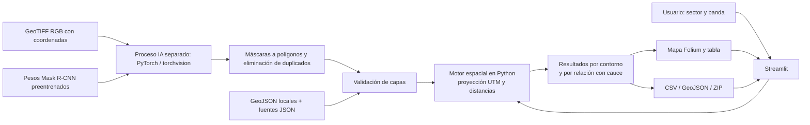

# Chullo · Análisis territorial

Prototipo funcional de detección de edificaciones y análisis de proximidad a torrenteras en Arequipa. Demostración preparada el 14 de octubre de 2026; arquitectura de código reorganizada y comprobada el 21 de octubre de 2026.

[Repositorio privado en GitHub](https://github.com/dpacoria21/gsti-teo) · [Manual de uso y arquitectura en Google Docs](https://docs.google.com/document/d/14cpDm8PPUGwlYi9FUeDbAjADxloQD7HMx4MysKCAnvw/edit) · [Instalación desde GitHub](docs/INSTALACION_GITHUB.md)

**Chullo ya funciona con una imagen real y el modelo preentrenado.** La imagen se exportó desde Google Earth Pro, con créditos **Google Earth; Image © 2026 Airbus**, y fecha mostrada por el visor **4 de marzo de 2026**. Se georreferenció con cuatro esquinas conocidas y dos puntos reservados de comprobación, conservando los originales y créditos. **Mariano Melgar** sigue disponible como segundo ejemplo, con ortofoto de dron CENEPRED del **5 de junio de 2018**. Cada sector conserva por separado su inventario Microsoft y las detecciones nuevas.

El detector es **Mask R-CNN ResNet50-FPN**, pesos preentrenados `building_footprints_usa.pth` de `giswqs/geoai`, ejecutado con PyTorch y torchvision. No se entrenó con Arequipa ni se utilizan contornos de Microsoft como respuesta de la IA. Detalles de arquitectura, pesos y limitaciones en [docs/MODELO_IA.md](docs/MODELO_IA.md).

## Mostrar la detección real de IA

1. Elegir **Chullo** en Área de estudio y **Detección IA desde imagen**. Es la selección inicial con los datos incluidos.
2. La captura original es de 8192 × 6390 píxeles. El GeoTIFF de trabajo es RGB, 2621 × 2045 píxeles a 0,5 m/píxel, EPSG:32719. La resolución de trabajo no acredita resolución nativa del sensor ni exactitud topográfica.
3. Pulsar **Detectar en esta imagen** para ejecutar de nuevo la red. Se muestra progreso, se guardan máscaras vectorizadas y se calculan sus distancias al cauce cartografiado.
4. Cambiar la puntuación mínima para ejecutar otra inferencia; cambiar la banda y pulsar **Analizar sector** para recalcular distancias sin ejecutar de nuevo la red.
5. Consultar un contorno, su puntuación y su distancia; descargar CSV, GeoJSON o ZIP desde Resultados y descargas. Fuentes y alcance contiene la procedencia completa de imagen y modelo.

La corrida guardada permite mostrar resultados sin repetir la inferencia; el botón sí ejecuta el modelo. Hay omisiones y falsos positivos visibles: las puntuaciones no son probabilidades calibradas. El ejemplo demuestra un flujo funcional, no precisión validada ni un censo de viviendas.

Con puntuación mínima 0,50, en **Chullo** se obtuvieron **237 contornos en el sector piloto**: **27** a 25 m o menos del eje y **56** a 50 m o menos. La imagen completa abarca un margen más amplio y produjo 1006 contornos; la aplicación selecciona los que intersectan el sector. El motor tardó aproximadamente 13 s en la GPU de esta computadora, además del arranque del proceso. En Mariano Melgar se conservan 180 contornos, 19 dentro de 25 m y 43 dentro de 50 m.

La comprobación de georreferenciación de Chullo obtuvo RMSE interno de 0,227 m en dos puntos reservados del mismo visor. **No es exactitud absoluta** de Google Earth, del eje OSM ni de las distancias; no hay control topográfico independiente. Los detalles están en `data/imagery/chullo/capture_report.json`, `manifest.json`, `georeferencing_points.csv` y `georeferencing_residuals.csv`. Los JPG originales y la evidencia de fecha se conservan en esa carpeta. Es una captura para esta demostración educativa, sujeta a [las condiciones de Google](https://about.google/brand-resource-center/products-and-services/geo-guidelines/); no es un banco de imágenes abierto ni se utilizó para entrenar.

La carga de un GeoTIFF RGB permite analizar otra imagen que intersecte el sector elegido. La aplicación selecciona los contornos que intersectan ese sector y conserva su geometría completa; otros lugares necesitan sus propias capas de cauces. No admite fotos sin coordenadas ni imágenes Sentinel-2 de 10 m para edificios individuales.

## Ejecutar en la nube

El punto de entrada `cloud/app.py` prepara el modelo verificado y utiliza dependencias CPU de `cloud/requirements.txt` para Python 3.12. Se incluye un Dockerfile para servidores Linux y una ruta de despliegue en Streamlit Community Cloud. Las instrucciones, requisitos y comprobaciones están en [docs/DESPLIEGUE_NUBE.md](docs/DESPLIEGUE_NUBE.md).

Las nuevas detecciones de la interfaz se separan por sesión y no reemplazan las demostraciones. El servidor procesa una inferencia a la vez. Las cargas y los resultados nuevos son temporales: descargar las exportaciones antes de cerrar la sesión.

## Abrir en esta computadora

Las dependencias y los datos ya están instalados. Hacer doble clic en **INICIAR.cmd**. Abre `http://127.0.0.1:8501` y reutiliza el servidor si ya está funcionando. También puede ejecutarse:

```powershell
powershell -NoProfile -ExecutionPolicy Bypass -File .\INICIAR.ps1
```

Para detener únicamente este servidor:

```powershell
powershell -NoProfile -ExecutionPolicy Bypass -File .\DETENER.ps1
```

No hay que descargar nuevamente los datos ni abrir una cuenta. Se recomienda Internet para el fondo de OpenStreetMap y los recursos del visor. El cálculo y las exportaciones utilizan los archivos locales. Si falla el visor o Internet durante la exposición, abrir **`outputs/presentacion/mapa_ia_chullo_25m.png`**. También están disponibles el mapa de IA de Mariano Melgar y el inventario de Chullo; los mapas estáticos funcionan sin conexión.

## Demostración del inventario de Chullo

Elegir **Chullo** y **Inventario Microsoft**.

1. Mostrar **Mapa del sector**, con 177 contornos y una banda inicial de 25 m: 31 dentro y 146 fuera.
2. Explicar el eje turquesa, los contornos ámbar dentro de la banda y los grises fuera. Cada distancia parte del punto más próximo del contorno, no de su centro.
3. Pulsar una edificación para ver su ficha. El selector **Identificador** permite acercar el mapa a un objeto concreto.
4. Cambiar a 50 m y pulsar **Analizar sector**. El conteo dentro de la banda cambia a 60. Cambiar el control sin pulsar el botón conserva el resultado aplicado y muestra un aviso.
5. Abrir **Resultados y descargas**, filtrar la tabla y descargar CSV, GeoJSON o ZIP. Los botones de descarga del análisis incluyen las 177 filas; el filtro solo modifica la tabla visible.
6. Mostrar **Fuentes y alcance** y explicar la procedencia y limitaciones. Volver a 25 m para terminar.

**Cómo presentar el resultado:** «El prototipo identifica 31 contornos a 25 metros o menos del eje cartografiado de Chullo en este sector piloto. Es una medida de proximidad que ayuda a priorizar una revisión territorial».

La banda no es una faja marginal legal ni una predicción de inundación. Fuera de la banda no significa seguro. Un contorno puede agrupar varias cubiertas o corresponder a otro uso; 177 contornos no equivalen a 177 viviendas verificadas. **En el modo inventario** no se ejecuta un detector: la IA se encuentra en el otro modo.

## Datos y resultados reproducibles de Chullo

| Elemento | Procedencia / alcance |
|---|---|
| Contornos de edificaciones | Microsoft Global ML Building Footprints, publicación 2026-08-13; fecha de captura local desconocida. |
| Torrentera | Eje OpenStreetMap ensamblado de cinco vías, 2 065,5 m de longitud. Identificación contrastada con cinco referencias de INGEMMET. |
| Sector | Recorte piloto de aproximadamente 0,284 km². Los contornos que intersectan el recorte se conservan completos. |
| Cálculo | Distancia mínima entre geometrías en WGS 84 / UTM zona 19S, EPSG:32719. |
| Mapa y exportación | Coordenadas WGS 84, EPSG:4326. |
| Peligro / faja marginal | No evaluados: no se incorporaron polígonos oficiales de estas zonas. |

| Banda analítica | Contornos dentro | Contornos fuera |
|---|---:|---:|
| 10 m | 21 | 156 |
| 25 m | 31 | 146 |
| 50 m | 60 | 117 |
| 100 m | 93 | 84 |

Se usa distancia sin redondear para clasificar; se muestran decimales solo para facilitar la lectura. La exactitud depende de los datos de origen. El eje continúa más allá del recorte para evitar truncarlo al calcular las bandas disponibles. La demo no inventaría todos los cauces de Arequipa.

La trazabilidad está en `data/sources.json`, `data/processed/chullo/validation.json`, `data/processed/chullo/build_manifest.json` y `docs/VALIDACION_DATOS.md`. Microsoft distribuye los edificios con CDLA Permissive 2.0; los datos de OpenStreetMap requieren atribución y están bajo ODbL 1.0. Los informes INGEMMET son referencias documentales; no se han convertido sus mapas en delimitaciones oficiales.

## Arquitectura implementada



En la ejecución local, el procesamiento ocurre en la laptop y el navegador se conecta a `127.0.0.1:8501`. La IA usa la NVIDIA RTX 5070 Ti disponible, con alternativa CPU; el mapa corre en `.venv` y lanza el detector en `.venv-ml`. En la configuración cloud, estos procesos se ejecutan en el servidor Linux: Streamlit atiende el navegador y lanza un worker CPU con el intérprete configurado mediante `CHULLO_ML_PYTHON`. Ambos modos intercambian archivos y progreso JSON. El mapa base solicita teselas a OpenStreetMap y recursos del visor a servicios externos; no se utiliza una API de inferencia de pago.

| Archivo | Responsabilidad |
|---|---|
| `app.py` | Punto de entrada: llama a `main()` únicamente cuando se ejecuta la aplicación. |
| `src/ui/` | Componentes Streamlit: controles, estado aplicado, métricas, mapa, tabla, fuentes, caché y estilos. |
| `src/application/detection_runner.py` | Valida la solicitud, ejecuta el proceso IA aislado, transmite progreso y gestiona el bloqueo de la corrida. |
| `src/application/images.py` | Selección de imágenes, archivos subidos identificados por hash y versiones para la caché. |
| `src/application/provenance.py` | Normaliza la procedencia y prepara las descripciones de imagen y detector. |
| `src/repositories/detections.py` | Lee una corrida completa; verifica estado, SHA256, conteos, coordenadas e intersección con el sector. |
| `src/repositories/run_publication.py` | Publica una corrida terminada con respaldo y recuperación de los archivos anteriores ante errores de escritura manejados. |
| `src/data_loader.py` | Carga, validación de geometrías, CRS, IDs y fuentes. |
| `src/spatial_analysis.py` | Distancias métricas, bandas y relación edificio–cauce. |
| `src/map_view.py` | Capas, leyenda, selección y fichas del mapa. |
| `src/export.py` | CSV, GeoJSON y ZIP con procedencia, parámetros y versiones. |
| `src/inference/` | Motor IA dividido en configuración, modelo, raster, posprocesamiento, procedencia y pipeline. |
| `src/building_detection.py` y `src/detection_client.py` | Fachadas de compatibilidad: mantienen los imports anteriores y delegan a los módulos responsables. |
| `src/settings.py` | Rutas del proyecto y de los entornos, independientes del directorio desde donde se ejecuta Python. |
| `scripts/run_detection.py` | Entrada CLI del detector y progreso JSON por línea. |
| `scripts/georeference_capture.py` | Ajuste afín, comprobación separada y conversión completa de una captura con puntos conocidos a GeoTIFF. |
| `scripts/export_inference.py` | Exportaciones y mapa estático de una ejecución de IA real. |
| `scripts/prepare_data.py` | Descarga y preparación reproducible de los datos de Chullo. |
| `scripts/export_demo.py` | Resultados y mapa PNG de respaldo. |
| `config/study_areas.json` | Áreas disponibles, rutas, CRS y banda máxima soportada. |

Para añadir otro sector se preparan sus capas y fuentes y se registra en la configuración; el algoritmo admite varios cauces y mantiene una fila por edificación. Cada sector puede tener una imagen incluida y ejecuciones independientes. Los siguientes pasos de validación y entrenamiento local están descritos en `docs/PLAN_DESARROLLO.md`.

### Cómo seguir desarrollando

Las dependencias apuntan desde la interfaz hacia los servicios y motores. El motor espacial y los repositorios no importan Streamlit. PyTorch se carga dentro del proceso de inferencia cuando se solicita ejecutar el modelo; leer resultados guardados no carga la red en el servidor del mapa. Importar `app.py` no dibuja pantallas ni inicia procesos.

El motor de IA tiene responsabilidades pequeñas:

- `config.py`: parámetros inmutables y validados (`InferenceParameters`).
- `model.py`: revisión y SHA256 fijados, descarga y carga estricta del checkpoint.
- `raster.py`: contrato del GeoTIFF RGB, coordenadas, resolución, ventanas y vista previa. El validador de archivos subidos usa este mismo contrato.
- `postprocess.py`: máscaras a polígonos, áreas, bordes, eliminación de duplicados e identificadores.
- `provenance.py`: combina la procedencia declarada con los datos medidos del raster sin permitir que se sobrescriban estos últimos.
- `pipeline.py`: coordina la ejecución y registra parámetros, versiones, dispositivo y resultados.

Para modificar una pantalla, trabajar en `src/ui/`; para cambiar distancias o bandas, en `src/spatial_analysis.py`; para sustituir la red, en `src/inference/model.py` manteniendo o adaptando explícitamente el contrato de máscaras. Un cambio de modelo requiere volver a validar los resultados: compartir la interfaz no garantiza la misma calidad.

Los archivos `data/` contienen entradas y procedencia, `models/` los pesos, `outputs/` los resultados y `tests/` las verificaciones. Las versiones de ejecución y desarrollo están fijadas por separado. No hay entrenamiento implementado: un futuro ajuste local necesita etiquetas revisadas y particiones geográficas independientes de entrenamiento, validación y prueba para evitar evaluar sobre imágenes usadas para entrenar.

Para instalar las herramientas de desarrollo sin cambiar las dependencias de ejecución:

```powershell
uv pip install --python .venv/Scripts/python.exe -r requirements-dev.lock.txt
.\.venv\Scripts\python.exe -m ruff check app.py src tests scripts/inspect_raster.py scripts/run_detection.py
.\.venv\Scripts\python.exe -m ruff format --check app.py src tests scripts/inspect_raster.py scripts/run_detection.py
```

`pyproject.toml` configura pytest y Ruff. El respaldo anterior a la reorganización está en `outputs/refactor/antes-modularizacion.zip`, solo en esta computadora.

Cada nueva detección se escribe primero en una carpeta de tentativa. El CLI verifica los resultados y publica el manifiesto al final; si falla la inferencia o una escritura durante la publicación, conserva o restaura la corrida anterior. Los eventos y errores se guardan en `.attempts/<identificador>/`. El bloqueo evita que dos detecciones escriban simultáneamente en el mismo destino. Es recuperación ante errores manejados, no un sistema transaccional resistente a cortes de energía.

## Instalar en otra computadora

### Clonar desde GitHub

El repositorio privado incluye código, datos procesados, imágenes GeoTIFF de trabajo y las dos detecciones guardadas. No incluye entornos Python, pesos del modelo, capturas JPG originales ni descargas brutas. Después de clonar, ejecutar `PREPARAR.ps1` e `INICIAR.ps1` permite consultar la demostración. Para repetir la inferencia, `PREPARAR_IA.ps1` instala el motor y descarga los pesos con revisión y SHA256 fijados. La imagen Google Earth/Airbus conserva su atribución y condiciones; su inclusión no la convierte en un dataset abierto.

Las instrucciones completas, diferencias con el ZIP local y archivos excluidos están en [docs/INSTALACION_GITHUB.md](docs/INSTALACION_GITHUB.md).

### Usar el paquete de entrega local

Copiar o extraer el paquete del proyecto. Requiere Windows y Python 3.12 (o `uv` que permita instalarlo), y conexión durante la instalación inicial:

```powershell
powershell -NoProfile -ExecutionPolicy Bypass -File .\PREPARAR.ps1
powershell -NoProfile -ExecutionPolicy Bypass -File .\PREPARAR_IA.ps1
powershell -NoProfile -ExecutionPolicy Bypass -File .\INICIAR.ps1
```

Las versiones exactas usadas se encuentran en `requirements.lock.txt` y `requirements-ml.lock.txt`. El paquete incluye datos procesados y pesos. Los entornos `.venv` y `.venv-ml` no son portables y se vuelven a crear en la otra computadora. `PREPARAR_IA.ps1 -Device cpu` instala la variante CPU; la primera instalación de PyTorch requiere una descarga considerable. Esta computadora ya tiene ambos entornos preparados.

## Verificación y regeneración

```powershell
.\.venv\Scripts\python.exe -m pytest -q
.\.venv\Scripts\python.exe scripts/export_demo.py --band 25
.\.venv\Scripts\python.exe scripts/prepare_data.py --offline
.\.venv-ml\Scripts\python.exe -m pytest tests/test_building_detection.py tests/test_inference_config.py tests/test_inference_pipeline.py tests/test_georeference_capture.py tests/test_raster_cli.py -q
.\.venv-ml\Scripts\python.exe scripts/run_detection.py --image data/imagery/chullo/chullo_rgb.tif --image-manifest data/imagery/chullo/manifest.json --output-dir outputs/inference/chullo_demo --threshold 0.5
.\.venv\Scripts\python.exe scripts/export_inference.py --area chullo --run outputs/inference/chullo_demo
```

La preparación `--offline` exige los originales en `data/raw`; están disponibles en esta computadora, pero no se incluyen en el paquete ligero. Las imágenes de revisión de `outputs/validacion` también se conservan solo en esta computadora. Para obtener los originales nuevamente, usar el script sin `--offline`.

Las pruebas de interfaz usan la corrida guardada, bloquean el lanzamiento de procesos IA y verifican que no se modifique. Las del motor comprueban raster, parámetros, máscaras y georreferencia sin descargar pesos ni ejecutar toda la red. La comprobación de inferencia real se realiza aparte con el comando indicado; vuelve a procesar la imagen y sustituye la corrida seleccionada al completarse.

Chullo IA conserva 237 contornos, 27 dentro de 25 m y 56 dentro de 50 m. Mariano Melgar IA: 180 contornos, 19 dentro de 25 m y 43 dentro de 50 m. El modo inventario de Chullo conserva 177 contornos, 31 dentro de 25 m y 60 dentro de 50 m. Tras reorganizar el motor, una nueva ejecución real en GPU generó un GeoJSON y una vista previa idénticos byte por byte a la demostración original. Evidencia local en `outputs/refactor/comparacion_ia.json`; detalle de verificaciones en `docs/VALIDACION_IA.md`.

## Cuando vuelva a responder el servicio IGN de Chullo

La imagen Google Earth ya está incluida. El descargador IGN queda como alternativa futura y no la reemplaza sin `--overwrite` explícito:

```powershell
.\.venv-ml\Scripts\python.exe scripts/download_chullo_imagery.py
```

El script falla explícitamente si no obtiene píxeles reales y georreferencia verificable. La fecha de captura y resolución nativa del servicio IGN siguen sin estar confirmadas; 0,5 m es la cuadrícula de exportación solicitada. No es necesario usar este servicio para la demostración preparada.

Los resultados listos para presentar están en `outputs/presentacion`. El ZIP de análisis contiene resumen CSV, relaciones con cauces, GeoJSON, metadatos y explicación de alcance. Los registros de arranque se guardan en `.runtime`; si el puerto 8501 está ocupado por otra aplicación, ejecutar `INICIAR.ps1 -Port 8502`.
