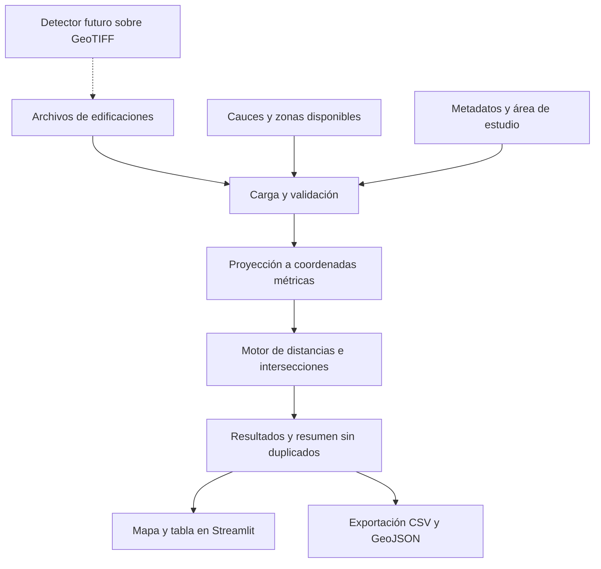
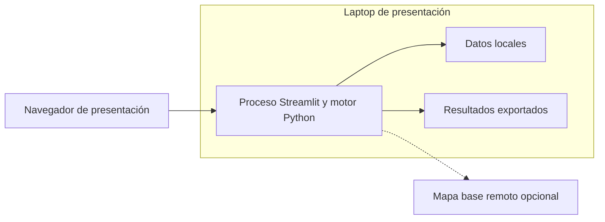

# Plan de desarrollo del prototipo de análisis de torrenteras

Fecha de planificación: 14 de octubre de 2026. Primera entrega: 15 de octubre de 2026, hora de Lima.

El primer prototipo permitirá seleccionar un sector, visualizar edificaciones y cauces, calcular distancias e intersecciones y exportar resultados. Chullo será el caso inicial. El motor aceptará otras torrenteras mediante archivos de datos, sin cambiar sus algoritmos.

**Actualización al 14 de octubre de 2026:** están implementados el inventario de Chullo (177 contornos) y el módulo real de IA con Mask R-CNN preentrenado. Chullo ya dispone de una captura real de Google Earth Pro / Airbus con fecha del visor 04/03/2026, georreferenciada con controles y comprobaciones. La inferencia obtiene 237 contornos en el sector, 27 dentro de 25 m y 56 dentro de 50 m del eje OSM. Mariano Melgar conserva su ortofoto CENEPRED de 2018 y 180 detecciones como segundo ejemplo. El servicio IGN no fue necesario para completar Chullo. No se entrenó un modelo nuevo; la georreferenciación y las detecciones requieren revisión, no validación de peligro.

La guía de ejecución y el alcance disponible están en [README.md](../README.md) y [MODELO_IA.md](MODELO_IA.md). Las secciones siguientes conservan decisiones del plan inicial y ampliaciones previstas; la implementación real usa PyTorch/torchvision con el checkpoint y constructor de GeoAI, en un proceso separado para IA.

## 1 Decisiones para empezar

| Elemento | Decisión |
|---|---|
| Producto inicial | Aplicación web local para análisis de proximidad y superposición de edificaciones con cauces y zonas documentadas. |
| Territorio | Un recorte pequeño y verificable de Chullo. Segundo cauce real si el tiempo permite preparar datos. |
| Edificaciones | Contornos existentes de Microsoft; Overture como alternativa, con procedencia y revisión local. |
| Imagen nueva | Implementada en Chullo con captura Google Earth Pro / Airbus y en Mariano Melgar con ortofoto CENEPRED. |
| Entrenamiento antes de mañana | Ninguno. |
| Modelo de inferencia implementado | Mask R-CNN ResNet50-FPN, pesos RGB GeoAI, ejecutado con torchvision. |
| Segundo modelo experimental | UNet++ con EfficientNet-B4 sobre WHU, solo si hace falta comparar o mejorar el modelo principal. |
| Torrentera | Capa geográfica revisada. No se entrenará una red neuronal para reconocer torrenteras en esta etapa. |
| Topografía | Ampliación con DEM y pysheds. No condiciona el análisis vectorial de mañana. |
| Interfaz y servidor | Streamlit y Folium; detector en un subproceso Python con entorno ML separado. |
| Almacenamiento inicial | Archivos GeoJSON o GeoPackage y metadatos JSON; resultados en memoria y exportación CSV. |
| Despliegue inicial | Laptop de presentación, con datos y dependencias locales. |

La elección anterior de React, FastAPI y PostGIS se conserva como arquitectura de evolución. Para esta entrega, integrar esos servicios consumiría tiempo que debe dedicarse a conseguir datos y validar las mediciones.

## 2 Qué verá el usuario mañana

1. Elegir un sector preparado de Chullo.
2. Ver las edificaciones y el cauce, con sus fuentes y fechas conocidas.
3. Elegir una banda analítica de 10, 25 o 50 metros.
4. Pulsar **Analizar sector**.
5. Ver contornos clasificados por relación espacial, una tabla y un resumen de conteos únicos.
6. Seleccionar una edificación para consultar su distancia, el cauce asociado, las zonas que intersecta y el tipo de referencia utilizado.
7. Descargar los resultados en CSV y, si queda tiempo, GeoJSON.

Los controles de carga de imagen e inferencia solo se habilitarán cuando la funcionalidad exista y se haya probado. La carga de contornos existentes no se presentará como detección ejecutada por nuestra aplicación.

La interfaz distinguirá resultados independientes:

| Resultado | Condición |
|---|---|
| Dentro de banda analítica | Distancia válida menor o igual al parámetro seleccionado. |
| Fuera de banda analítica | Distancia válida mayor que el parámetro. |
| Intersecta zona de peligro | Existe una capa identificada y una intersección con ella. Mostrar su categoría y fuente. |
| Intersecta faja marginal | Existe una delimitación sustentada y una intersección con ella. |
| Sin evaluación | Falta la capa necesaria, no cubre el lugar o la geometría no se puede utilizar. |

Se mostrarán varias etiquetas si corresponden. Una banda analítica no recibirá el nombre de faja marginal ni de zona de peligro. La aplicación contará edificaciones; llamar a esos objetos viviendas o estimar habitantes exige información adicional.

## 3 Modelos y algoritmos seleccionados

### Edificaciones existentes para la primera entrega

Microsoft Global ML Building Footprints distribuye polígonos derivados de modelos y tiene datos de Perú. Se utilizará como inventario de entrada y referencia inicial, no como un detector invocado al subir una imagen. Overture permite descargar edificios por área; cuando se utilice, se conservarán los identificadores y la procedencia disponible, sin atribuir todos sus objetos a Microsoft. [Microsoft](https://github.com/microsoft/GlobalMLBuildingFootprints) y [descarga de Overture](https://docs.overturemaps.org/getting-data/overturemaps-py/).

Antes del cálculo, revisar una muestra local de contornos y verificar alineación, duplicados y cobertura. Una fecha de publicación del conjunto no prueba la fecha de la imagen de cada edificio.

### Modelo principal para imágenes nuevas

- Arquitectura: **Mask R-CNN ResNet50-FPN**, a través de `GeoAI BuildingFootprintExtractor`.
- Pesos: repositorio `giswqs/geoai`, archivo `building_footprints_usa.pth`, variante RGB. Revisión observada: `aa2b25d27b2c78f0e92c7b6a4813a571f9bc2288`. Fijarla al descargar y registrar hash; el archivo tiene aproximadamente 176 MB.
- Entrada: imagen RGB de alta resolución georreferenciada, preferentemente GeoTIFF. No sustituirla por Sentinel-2 remuestreado.
- Salida: instancias de edificaciones, máscaras, contornos y puntuaciones del detector. La puntuación no equivale a probabilidad de daño.
- Adaptación: primero evaluar sin entrenar; ajustar con ejemplos de Arequipa solo si la evaluación local lo justifica.

El ejemplo publicado ya incluye inferencia por ventanas y exportación vectorial. Los pesos están orientados a Estados Unidos, por lo que deben comprobarse con techos, materiales y densidad urbana locales. [Tutorial](https://opengeoai.org/examples/building_footprints_usa/) y [pesos RGB y licencia declarada MIT](https://huggingface.co/giswqs/geoai).

GeoAI se instalará en un entorno de ML separado. La metadata consultada de `geoai-py` requiere Python 3.12 o superior; no asumir que ejemplos de instalación antiguos siguen describiendo sus requisitos actuales. Fijar versiones después de comprobar la instalación y una inferencia de prueba. [Metadata del paquete](https://pypi.org/project/geoai-py/).

### Modelo de comparación posterior

`giswqs/whu-building-unetplusplus-efficientnet-b4`: UNet++ con EfficientNet-B4, imágenes RGB de 512 × 512 píxeles y entrenamiento de referencia a 0,3 m/píxel. Produce una máscara de edificio y fondo; contornos pegados pueden terminar unidos al vectorizar. Se comparará con el modelo principal si aparecen errores sistemáticos o dificultades de instalación. Los pesos declaran Apache-2.0. Las métricas publicadas en WHU no se trasladan a Chullo. [Ficha del modelo](https://huggingface.co/giswqs/whu-building-unetplusplus-efficientnet-b4).

### Cauces y relieve

Para mañana, utilizar geometrías revisadas. Posteriormente, `pysheds` puede proponer redes de drenaje y cuencas desde un DEM. Es un algoritmo hidrológico, no un segundo modelo entrenado. La extracción suele entregar ejes, no los bordes del cauce. Incluir la cuenca aguas arriba al analizar flujo; un recorte limitado a la fotografía puede omitir aportes externos. [pysheds](https://github.com/pysheds/pysheds) y [GRASS r.watershed](https://grass.osgeo.org/grass-stable/manuals/r.watershed.html).

### Cambio urbano previsto en el artículo

En una fase posterior se entrenará un **Random Forest** con series Sentinel-2, bandas e índices como NDVI y NDBI, para comparar superficie construida entre 2019 y 2025. Su unidad será área o celda, separada del inventario de edificaciones. Reutilizar partes del procesamiento de Tingzon exige adaptar dependencias y crear etiquetas locales; su repositorio no incluye las etiquetas originales. [Artículo](https://arxiv.org/abs/2008.13583) y [código](https://github.com/thinkingmachines/geoai-immap/).

## 4 Datos y condiciones para utilizarlos

| Dato | Fuente y acción | Condición de incorporación |
|---|---|---|
| Área de estudio | Delimitar un pequeño sector de Chullo y guardar su polígono. | Límites revisados; área y coordenadas conocidas. |
| Edificaciones | Descargar un recorte de Microsoft u Overture. | Objetos reales dentro del sector, geometrías utilizables y procedencia conservada. |
| Cauce | Buscar vector oficial; en su ausencia, digitalizar un tramo desde cartografía identificada y revisarlo. | Rotular origen y si representa eje o polígono del cauce. |
| Peligro | Mapas del informe INGEMMET A7406, u otra capa pertinente con fecha y alcance. | Un PDF requiere georreferenciación, digitalización y comprobación; no es una capa lista para el motor. |
| Faja marginal | Documentación y delimitación aprobada de ANA. | Verificar instrumento, geometría, vigencia y cobertura. Si falta, mantener estado no evaluado. |
| Imagen de alta resolución | Ortofoto IGN, municipio, universidad, dron u otro proveedor. | Fecha, resolución real, CRS y usos permitidos comprobados antes de incorporarla al módulo ML. |
| DEM | Copernicus GLO-30 como contexto; mejor terreno local cuando esté disponible. | Registrar resolución y fecha. Un DSM de 30 m no resuelve todos los cauces urbanos estrechos. |

El [servicio IGN de ortofoto de Arequipa](https://www.idep.gob.pe/geoportal/rest/services/IMAGENES/ORTOFOTO_AREQUIPA/MapServer) existe y su capa está rotulada a escala 1:1000. Esa escala no determina por sí sola el tamaño de píxel ni la fecha de captura. Se considera una fuente candidata; su visualización pública no confirma permisos de entrenamiento o redistribución.

El [informe A7406 de INGEMMET](https://sigrid.cenepred.gob.pe/sigridv3/documento/16497/descargar) incluye mapas y análisis de Chullo. Sus puntos críticos son ubicaciones de infraestructura y observaciones; no se unirán para inventar la geometría del cauce. El [registro ANA de Chullo](https://alicia.concytec.gob.pe/vufind/Record/ANAI_30b8b985a29d4b24c000e35c28a77eb2/Details) acredita la existencia de un estudio, pero no sustituye la revisión de la delimitación aplicable. [Características de Copernicus DEM](https://dataspace.copernicus.eu/explore-data/data-collections/copernicus-contributing-missions/collections-description/COP-DEM).

Cada fuente tendrá URL, entidad, fecha de descarga, fecha del dato cuando se conozca, licencia o condiciones, CRS, cobertura y estado de revisión. Los faltantes se guardarán como nulos, no como cero ni como ausencia de exposición.

### Ruta de adquisición comprobada para empezar

**Edificaciones:** el índice de Microsoft incluye Perú y la tesela `210031232`, publicación de 13 de agosto de 2026. Se comprobó acceso y lectura en memoria del archivo comprimido de aproximadamente 22,7 MiB, con geometrías en el entorno de Chullo. La descarga persistente, selección local y revisión siguen pendientes. [Archivo de la tesela](https://bfppub.z5.web.core.windows.net/2026-08-13/global-buildings.geojsonl/RegionName=Peru/quadkey=210031232/part-00104-110f5303-ff85-4c71-a2bf-c6070024fec8.c000.csv.gz). Descargar una copia, preservar el original y seleccionar los objetos del sector final conservando sus geometrías completas. Hay registros con altura y confianza iguales a `-1`; tratarlos como desconocidos. La fecha de publicación no se mostrará como fecha de captura.

**Cauce candidato:** la API pública de OpenStreetMap devuelve cuatro tramos conectados con etiqueta `waterway=stream` en un recorte cercano a Chullo: `25980163`, `535091453`, `535091454` y `781522545`. [Consulta del recorte](https://api.openstreetmap.org/api/0.6/map?bbox=-71.554,-16.403,-71.550,-16.397). No tienen un nombre que por sí solo confirme Chullo: antes del uso, contrastar la geometría con cartografía INGEMMET y una referencia visual identificada. Obtener cada vía completa mediante `/api/0.6/way/{id}/full` y ensamblar por nodos compartidos. Conservar atribución OpenStreetMap y condiciones del conjunto.

Estos tramos representan un eje de drenaje. El dato permite preparar un caso de proximidad cuando se confirme su correspondencia local; no representa el borde del cauce ni la faja marginal. Si la comprobación falla, volver a digitalización revisada del tramo desde una fuente cartográfica identificada.

La dependencia de datos pendiente para demostrar un análisis real de Chullo es validar ese eje o preparar un trazado alternativo verificable. Se propone el recorte pequeño de la consulta como piloto, sujeto a esa comprobación.

**Referencia adicional posterior:** el [servicio ANA de faja marginal](https://geosnirh.ana.gob.pe/server/rest/services/P%C3%BAblico/FajaMarginal/MapServer/127) devuelve puntos de vértices e hitos asociados a Chullo y distintas resoluciones. La respuesta no es un polígono aprobado listo para analizar: no unir automáticamente todos esos puntos ni usarlos como eje de cauce. Incorporar esta fuente solo después de revisar las resoluciones y reconstruir su geometría de forma sustentada.

## 5 Arquitectura interna



Se propone esta separación de responsabilidades, sin crear servicios independientes:

| Módulo | Responsabilidad |
|---|---|
| `data_loader` | Leer archivos, verificar esquema, CRS, IDs y metadatos. |
| `geometry_validation` | Detectar geometrías vacías o inválidas y registrar correcciones o exclusiones. |
| `spatial_analysis` | Calcular distancias, bandas e intersecciones sobre geometrías métricas. |
| `classification` | Aplicar reglas explícitas y conservar estados no evaluados. |
| `map_view` | Representar resultados y ficha de cada objeto. |
| `export` | Exportar valores, parámetros y fuentes. |
| `building_detection` | Adaptador futuro de imagen georreferenciada a contornos con el mismo contrato de datos. |

La función de análisis recibirá edificaciones, cauces, zonas, área y parámetros. No contendrá nombres ni coordenadas de Chullo dentro de su lógica. La configuración del caso seleccionará los archivos y el CRS.

## 6 Tecnología y despliegue

| Parte | Tecnología inicial |
|---|---|
| Lenguaje | Python 3.12. |
| Interfaz y servidor | Streamlit. |
| Mapa | Folium y streamlit-folium. |
| Datos geográficos | GeoPandas, Shapely, PyProj y Pyogrio. |
| Tablas y exportación | Pandas. |
| Revisión cartográfica | QGIS, si está disponible en el equipo. |
| Pruebas del cálculo | Pytest con unos pocos casos geométricos conocidos. |
| Imágenes e inferencia posteriores | Rasterio, PyTorch y GeoAI en entorno separado. |

Python 3.12 está disponible en el equipo revisado. Las bibliotecas principales del prototipo no están instaladas en ese intérprete; preparar un entorno virtual es la primera tarea técnica. Las versiones exactas se fijarán en un archivo de dependencias después de una instalación comprobada, sin inventar un conjunto de versiones compatible. [Instalación de Streamlit](https://docs.streamlit.io/get-started/installation/command-line), [GeoPandas](https://geopandas.org/en/stable/getting_started/install.html) y [streamlit-folium](https://github.com/randyzwitch/streamlit-folium).



La ejecución prevista será `python -m streamlit run app.py` una vez implementada la aplicación. El ensayo debe hacerse desde el entorno instalado en la laptop final. El cálculo dependerá de archivos locales; los mapas base pueden requerir Internet. Para contingencia, conservar un mapa estático de resultados y el CSV. No prometer funcionamiento totalmente desconectado de Folium sin comprobar también sus recursos JavaScript.

El prototipo no necesita una base de datos ni GPU para los cálculos vectoriales. Docker y publicación en una VM quedan como tareas opcionales, posteriores al ensayo local. La arquitectura futura puede separar React/Leaflet, FastAPI, PostGIS y un proceso de inferencia, reutilizando `spatial_analysis` y el contrato de datos.

## 7 Contrato de datos

| Capa | Campos mínimos |
|---|---|
| Área | `area_id`, `name`, geometría, `analysis_crs`. |
| Edificación | `building_id`, geometría poligonal, `source_id`, `observed_at` si se conoce, `review_status`. |
| Cauce | `river_id`, `name`, geometría, `geometry_role` como `axis` o `channel_polygon`, `source_id`. |
| Zona | `zone_id`, tipo `hazard` o `official_margin`, geometría, categoría si existe, `source_id`, cobertura conocida. |
| Fuente | `source_id`, entidad, URL, fecha del dato y descarga, condiciones de uso, CRS original y estado de revisión. |
| Resultado | `analysis_id`, `building_id`, `river_id`, distancia, referencia de distancia, banda usada, pertenencia a banda, relaciones con zonas y motivos de no evaluación. |

Una edificación puede tener relaciones con varios cauces y zonas. El resumen contará IDs únicos; el detalle conservará todas las relaciones. Guardar por separado la distancia al cauce más cercano y la lista de zonas intersectadas. No asumir que el cauce más cercano explica todos los peligros.

El CSV de detalle tendrá una fila por par edificación y cauce evaluado. Un CSV de resumen opcional tendrá una fila por edificación. Las relaciones con zonas se exportarán en una tabla independiente si hay varias por objeto; así se evita multiplicar filas y alterar conteos al cruzar las tres capas.

Los archivos de intercambio se mostrarán en coordenadas geográficas; en Arequipa los cálculos se realizarán en WGS 84 / UTM 19S, EPSG:32719. Para otras regiones se deberá configurar un CRS métrico adecuado. La primera versión no promete análisis correcto de cualquier región mundial sin esa configuración.

## 8 Reglas de cálculo

1. Validar CRS y cobertura. No asignar EPSG:4326 a un archivo desconocido solo para conseguir que se dibuje.
2. Transformar las geometrías a EPSG:32719 para el caso Arequipa.
3. Con una línea de cauce, calcular distancia mínima desde la huella de la edificación al eje y rotularla así.
4. Con un polígono de cauce, calcular distancia mínima entre ambas geometrías; si se intersectan, registrar cero. Para una edificación externa corresponde a la separación respecto al borde del cauce.
5. Considerar dentro de la banda cuando la distancia sea menor o igual al umbral elegido.
6. Evaluar peligro y faja marginal de manera independiente, solo dentro de coberturas válidas.
7. Distinguir contacto con el límite y superposición de área positiva. Si se informa porcentaje de una edificación dentro de una zona, calcular `área(edificación ∩ zona) / área(edificación) × 100`.
8. No utilizar geometrías simplificadas para visualización en los cálculos de distancia y área.

Seleccionar las edificaciones cuya huella intersecta el área de estudio, conservar el polígono completo y marcar las que cruzan el límite. Cargar los cauces completos y un margen alrededor del sector, al menos tan amplio como la banda máxima analizada. No cortar el cauce al borde de la pantalla antes de medir. La distancia más cercana se referirá a los cauces cartografiados disponibles; si la cobertura es insuficiente, explicitar el límite de búsqueda o dejar el resultado sin evaluar.

La precisión del cálculo numérico y la exactitud de las fuentes son distintas. Las mediciones deben interpretarse según la resolución y alineación de los datos; agregar decimales no mejora esas fuentes.

## 9 Plan de trabajo hasta mañana

Estimación orientativa para un equipo con tres frentes de trabajo: entre 8 y 13 horas-persona de trabajo principal, más margen por preparación de datos. No equivale a un plazo garantizado. Priorizar una demostración completa sobre un sector pequeño.

| Orden | Trabajo | Responsable sugerido | Criterio para terminar |
|---|---|---|---|
| 1 | Preparar entorno Python y estructura del proyecto. | Integración | Arranca una página Streamlit y se importan bibliotecas geográficas. |
| 2 | Obtener recorte de edificaciones y cauce; guardar metadatos. | Datos | Se superponen correctamente en un mapa y se conoce qué representa cada geometría. |
| 3 | Implementar funciones de distancia y bandas. | Análisis | Casos de distancia conocida y límite exacto pasan. |
| 4 | Implementar lectura de zonas opcionales y estados faltantes. | Análisis | La ausencia de una capa produce no evaluado, no un resultado inventado. |
| 5 | Construir mapa, selector de banda, tabla y ficha. | Interfaz | Cambiar el parámetro actualiza resultados reales. |
| 6 | Añadir exportación CSV y conteos únicos. | Integración | Lo exportado coincide con el mapa y la tabla. |
| 7 | Revisar muestra y ensayar la presentación. | Todo el equipo | El flujo completo funciona en la laptop final sin descargas de datos durante la exposición. |

Con cuatro integrantes, separar validación y documentación. Con cinco, asignar investigación de imágenes y preparación del detector futuro a una persona sin bloquear los tres frentes principales.

Puntos de decisión:

- Al cerrar las primeras dos horas, fijar la fuente de edificios y el tramo de cauce. Si no hay un vector oficial, usar una digitalización revisada y rotulada como referencial.
- Si un recorte de edificios no está accesible, probar la segunda fuente; no descargar todo Perú para una demo de un tramo.
- Si falta la faja marginal aprobada, excluir su evaluación y conservar la banda analítica con su nombre correcto.
- Si no se consigue geometría real verificable, un caso sintético sirve únicamente para validar el software y debe presentarse separado de resultados de Chullo.
- Después de completar y ensayar el flujo principal, incorporar un segundo cauce real si sus datos están preparados. La capacidad de recibir varios cauces puede verificarse antes con casos geométricos controlados, sin afirmar que ya se evaluaron dos torrenteras reales.
- Inferencia con imagen nueva solo si imagen, condiciones de uso, entorno, pesos y una ejecución verificada están disponibles. No consumir el margen de ensayo intentando resolver instalación de ML.

## 10 Criterios de aceptación

- [ ] Un sector real tiene edificios y cauce con fuente identificada.
- [ ] Distancias expresadas en metros y con referencia al eje o al polígono según corresponda.
- [ ] Intersección con el cauce devuelve distancia cero.
- [ ] Una geometría situada a una distancia conocida devuelve ese valor dentro de la tolerancia numérica definida.
- [ ] La condición exactamente igual al umbral se trata de forma consistente.
- [ ] Una edificación asociada a dos cauces conserva ambas relaciones y aparece una sola vez en el total.
- [ ] Si se incorporan zonas con geometría validada, distinguir contacto y área positiva de superposición. Esta extensión no bloquea el mínimo de distancias y bandas.
- [ ] Geometría inválida, CRS desconocido y cobertura ausente tienen mensajes claros y no generan clasificación automática.
- [ ] Un conjunto de unas 20 edificaciones se revisa visualmente y varias distancias se contrastan de forma independiente. Es una comprobación operativa, no una estimación estadística de exactitud del modelo.
- [ ] El CSV conserva IDs, valores, parámetros y fuentes y coincide con la pantalla.
- [ ] La aplicación arranca en la laptop de presentación y dispone de mapa estático y resultados exportados como respaldo.

## 11 Ampliación después de la entrega

| Etapa | Resultado | Condición de inicio |
|---|---|---|
| A | Inferencia real con Mask R-CNN sobre un recorte de Arequipa. | Imagen RGB georreferenciada y uso permitido; entorno ML operativo. |
| B | Evaluación local del detector sin ajuste. | Etiquetas manuales independientes y muestra de distintas condiciones. |
| C | Fine-tuning del modelo principal, si aporta mejora. | Errores documentados, etiquetas suficientes y recursos de entrenamiento. |
| D | Prueba de transferencia a otra torrentera. | Área de prueba reservada antes del ajuste, con revisión local. |
| E | Pendiente y drenajes propuestos desde DEM. | Datos de terreno y extensión de cuenca adecuados; contraste con cauces conocidos. |
| F | Cambio de superficie construida 2019–2025 con Random Forest. | Compuestos temporales comparables, etiquetas y validación independiente. |
| G | Integrar censo y daños documentados para completar indicadores del artículo. | Unidades, fechas y cobertura compatibles; control de duplicados por evento. |
| H | Despliegue compartido con API y base espacial. | Necesidad de usuarios concurrentes, persistencia y procesamiento de nuevas imágenes. |

Para el ajuste del detector, comenzar con un conjunto piloto de algunos cientos de edificaciones etiquetadas y negativos difíciles. Esa cantidad sirve para explorar errores; la cantidad final dependerá de diversidad y curvas de aprendizaje. Separar entrenamiento, validación y prueba por sectores antes de generar ventanas, evitando que imágenes vecinas o superpuestas se filtren entre particiones.

Comparar el modelo original y el ajustado con el mismo conjunto de prueba. Medir precisión, recall y F1 por objeto con una regla de correspondencia IoU definida, además de IoU de máscaras, edificios unidos u omitidos y efecto sobre distancias. Reservar otra torrentera para evaluar transferencia. No fijar una precisión prometida antes de medirla. Las huellas de terceros usadas como etiquetas débiles no pueden actuar simultáneamente como verdad independiente de prueba.

En el análisis temporal, validar cambios con fechas comparables y clases de suelo desnudo y vegetación. Sentinel-2 mantiene el papel de cambio agregado; el inventario detallado conserva su propia fecha. Esta primera entrega es una parte del proyecto académico, no la ejecución completa del estudio 2019–2025.

## 12 Aporte propio y presentación

El aporte de esta versión será el motor que relaciona edificaciones con varios cauces, conserva fuentes, calcula indicadores verificables y genera resultados consultables. Reutilizar contornos, bibliotecas y pesos se documentará explícitamente. Las conclusiones de exposición dependerán de las capas realmente disponibles.

Guion breve de demostración: seleccionar Chullo, identificar las fuentes, ejecutar el análisis con una banda, inspeccionar dos edificaciones, cambiar la banda, explicar las diferencias y exportar el CSV. Mostrar después los diagramas de funcionamiento y despliegue, y el módulo de inferencia previsto.

Para sustentar el diseño, el trabajo de [Bhuyan y colaboradores](https://link.springer.com/article/10.1007/s11069-022-05612-4) combina detección y análisis de exposición; [Thouret y colaboradores](https://www.frontiersin.org/journals/earth-science/articles/10.3389/feart.2022.865989/full) aporta el antecedente de flujos y edificaciones en Arequipa. El contexto y alcance del proyecto provienen de [la presentación del equipo](<C:/Users/diego/Downloads/1ra Presentacion articulo.pdf>).

## 13 Estructura de archivos propuesta

La siguiente estructura es para la implementación; actualmente solo existe este plan.

```text
app.py
requirements.in
requirements.lock.txt
README.md
src/
  data_loader.py
  geometry_validation.py
  spatial_analysis.py
  classification.py
  map_view.py
  export.py
config/
  study_areas.json
data/
  raw/
  processed/
  sources.json
outputs/
tests/
  test_spatial_analysis.py
docs/
  PLAN_DESARROLLO.md
```

El módulo de inferencia y sus dependencias se añadirán cuando comience esa etapa. Los datos originales se preservarán; los recortes y correcciones quedarán en archivos derivados. Un manifiesto registrará parámetros, fuentes, fecha de análisis y versiones utilizadas.
